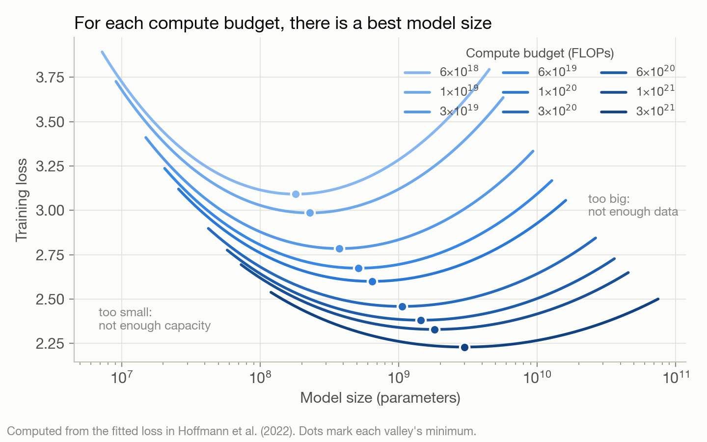
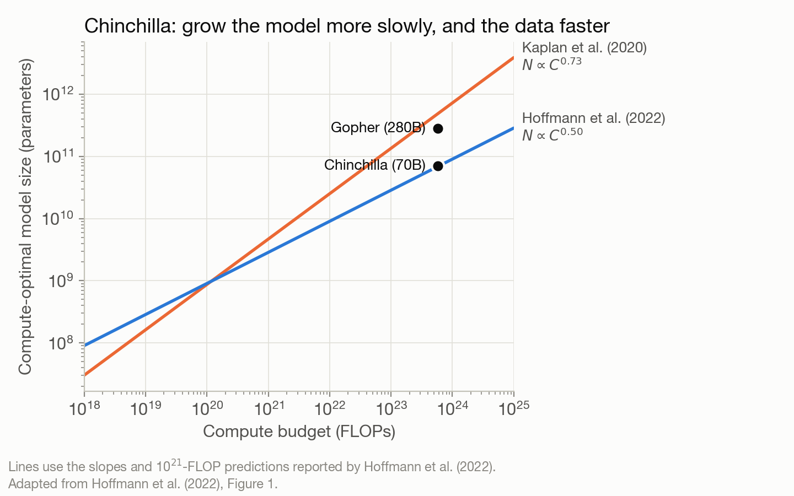

<!-- Skeleton notes are in the bullets under each heading. Replace them with your text.
     Word targets are in the comments. Figures go in images/posts/scaling/.
     Tone: friendly and curious, "here's how I think about it", not "people get this wrong". -->

<!-- Opening hook, ~100 words (optional): a short, personal way in. E.g., what got you
     curious about scaling, or the question you kept asking yourself when you started
     building a multiomic foundation model. -->

## Part 1: Why do we care about scaling?

### 1.1 The promise(?) of foundation models for biology
<!-- ~200 words. Purpose: motivate the whole post before any theory. DRAFT v1. -->

In just a few years, foundation models have become an everyday part of how many of us work. We ask a chatbot to explain a paper, plan and implement an analysis pipeline, check our results against the current literature, and suggest the next hypothesis to test. Behind all of these tasks is the same underlying model, with some extra training on top and access to tools like web search and code execution. That's the core idea behind a foundation model: train one large model on a huge amount of broad data, then reuse it for many different tasks, instead of building a new model from scratch each time.[^bommasani]

Biology has had a few of these moments too, where a single model changed what the field thought was possible. The clearest is AlphaFold. Predicting a protein's 3D structure from its amino acid sequence had resisted decades of work, and in 2020 AlphaFold began producing predictions that were often close to experimental accuracy.[^alphafold] Its creators shared the 2024 Nobel Prize in Chemistry.[^nobel] More recently, AlphaGenome reads up to a million letters of DNA and predicts, in a single model, how a change in that sequence affects gene expression, splicing, and chromatin accessibility across many cell types.[^alphagenome] (Strictly speaking, neither is a foundation model in the usual sense, but both show what large models trained on biological data can do.)

So it's natural to wonder whether we can borrow this success story from computer science for other kinds of biological data, like single-cell and multiomic measurements, where large atlases now span millions of cells. Before we do, though, two questions are worth pausing on. The first is what we actually want a foundation model in biology to do. "A model that understands cells" is inspiring but vague, and the answer shapes what data we train on and how we judge success. Researchers closer to the biology have written thoughtfully about this, and the perspective by Bunne et al. on building an AI virtual cell is a great place to start.[^bunne] The second question, and the focus of this post, is how we should think about scaling. It's tempting to picture scaling as buying more GPUs or collecting more data, but those are only part of the story.

In Part 1, I'll build up the intuition and evidence for why scaling works at all. In Part 2, I'll walk through what it takes in practice.

### 1.2 More data, bigger models
<!-- ~300 words. Purpose: the intuition that data and model size grow together. DRAFT v1. -->

Let's start with something familiar. In an experiment, the more samples we collect, the more precise our estimate: the standard error of a mean shrinks roughly like $$1/\sqrt{n}$$. Each extra sample helps a little less than the one before, but on a log scale the pattern is perfectly steady: every tenfold increase in samples cuts the error by the same factor, about three. Plotted on log-log axes, that's a straight line, and as we'll see in Section 1.3, it's exactly what scaling laws look like.

Precision is only half the story, though. A model can only learn what it is flexible enough to express. Fit a straight line to data that curve, and more samples just make us more confident about the wrong line. The error that comes from the model's shape doesn't shrink, no matter how much data we add. And biological data are rarely straight lines. Cells moving through development or responding to pathology trace out complicated, curved paths in gene expression space (what mathematicians call a manifold), and capturing that takes a more flexible model, which in practice means more parameters.

However, we also know that with too little data, a flexible model has enough freedom to fit the noise along with the signal. The fit will look great on the data it was trained on but will do poorly on new data (this is called overfitting). More data is what keeps a flexible model honest: with enough samples, the noise averages out, and the extra flexibility goes toward the real structure.

In other words, data and model size go hand in hand. More data lets us afford a bigger model, and a bigger model lets us get more out of the data. Grow only one and we eventually hit a wall: either the model is too simple to use the extra data, or there isn't enough data to support the extra parameters.

This is the intuition behind scaling laws: they describe how fast performance improves as we grow data and model size, and how to balance the two.

**For the curious.** Classical statistics pictures this as a U-shaped curve: error on new data first falls as the model gets more flexible, then rises once it starts overfitting. Modern deep learning brought a surprise. Very large models, with far more parameters than data points, often generalize well anyway, a phenomenon called "double descent." Overfitting is still real, but where the wall sits turns out to be more subtle than the textbook picture suggests.
{: .notice--info}

<!-- FIGURE: three panels on the same curved data.
     (a) a straight line through lots of points: too simple, more data doesn't help;
     (b) a wiggly curve through a few points: overfits;
     (c) the same flexible model with lots of points: follows the true curve.

-->

### 1.2' Same story but with a theoretical view: A VC-dimension view
<!-- ~350 words. Purpose: make "data and model size go hand in hand" a little more precise. DRAFT v1, to revisit. -->

Section 1.2 left us with a balancing act: flexible models need enough data to stay honest. Statistical learning theory gives us a way to make that idea a bit more precise, through something called the VC dimension, after Vladimir Vapnik and Alexey Chervonenkis.[^vc]

The idea is to measure a model's flexibility by asking how many data points it can fit no matter how they're labeled. Take a straight line used to separate two groups of points on a page. Give it any three points (not all in a row), color them however you like, and some line can always split the colors apart. With four points, that breaks down: put two red and two blue at opposite corners of a square, and no single line can separate them. So the VC dimension of a line on a page is three. In general it grows with the number of things the model can adjust, roughly its number of parameters.

Why does this matter? If a model is flexible enough to fit any labeling of our data, then fitting our data perfectly tells us nothing, because it would have fit random labels just as well. Learning only means something when the data outnumber the model's flexibility. Biologists already know a version of this: a regression with as many variables as samples fits perfectly and means nothing, which is why clinical prediction models follow rules of thumb like "about ten events per variable."[^epv]

The theory turns this into a rough rule. The gap between how well a model does on its training data and on new data shrinks roughly like

$$\sqrt{\frac{d}{n}},$$

where $$d$$ is the VC dimension and $$n$$ is the number of samples. Two things fall out of this. First, the $$1/\sqrt{n}$$ from Section 1.2 is back: more data still helps in a steady, log-log-straight way. Second, to keep the gap fixed as the model grows, the data have to grow along with it. That's "data and model size go hand in hand," now with a formula attached.

Like any formula, this one comes with assumptions, and two of them matter a lot for biology. First, it assumes our samples are independent draws from the same population we'll later apply the model to. In single-cell data that's rarely true: cells from the same donor, tissue, or batch share a lot, so a hundred thousand cells from one donor are not a hundred thousand independent looks at human biology. The effective $$n$$ can be much smaller than the number of cells, a thread we'll pick up in Section 2.2. Second, it only promises that the model will do about as well on new data as on its training data, for the same task it was trained on. It says nothing about downstream tasks, like annotating cell types or predicting perturbation responses, which are usually what we actually care about. Even in computer science, the cleanest scaling laws are for the pretraining loss (how well the model predicts held-out text). Downstream performance is much noisier: it can stay flat for a while and then jump,[^emergent] and how smooth it looks depends partly on how we choose to measure it.[^mirage] We'll come back to this in Section 2.5.

There's also a catch in the other direction, and it's a good one. VC bounds describe the worst case, and for modern neural networks they are far too pessimistic. Large networks can memorize completely random labels,[^zhang] so by this measure they should overfit badly, yet on real data they often generalize well (the double descent surprise from Section 1.2). Theory gives us the right intuition about the trade-off, but it can't tell us the actual numbers for a given model and dataset. To get those, we measure them, and that's what scaling laws do.

<!-- FIGURE: left, three points with all 8 colorings, each split by a line; right, four points in the
     red/blue corner pattern that no line can split.

-->

### 1.3 Scaling laws: an empirical surprise
<!-- ~250 words. Purpose: scaling laws are measured, not derived, and careful experiments on small
     budgets let us predict larger ones. Two experiments: model vs. data (Chinchilla, Figure 1) and
     hyperparameters vs. scale (DeepSeek/μP, Figure 2); Kaplan vs. Chinchilla in the box (Figure 3). -->

Section 1.2 ended on a puzzle. Worst-case theory says huge neural networks should overfit, yet in practice they keep getting better as they grow. Earlier work had hinted that this improvement is predictable,[^hestness] and in 2020 Kaplan and colleagues at OpenAI showed it cleanly: as they grew model size, data, and compute, the loss fell along a straight line on log-log axes, a power law, across more than seven orders of magnitude.[^kaplan]

What makes this useful is prediction. With careful experimental design (here, the experiments are on models rather than on cells), we can run a series of small, cheap training runs, fit the curve, and estimate how a model will do on a budget many times larger. Just as in the lab, "careful" means controlling the right variables. Chinchilla shows how to balance model size against data for a given budget,[^chinchilla] and μP shows how to choose hyperparameters, like the learning rate, so that what we learn on small models carries over to big ones.[^mup] 

To see what such an experiment looks like, take Chinchilla. Training cost is measured in compute, counted in FLOPs (floating-point operations, the individual multiplications and additions a computer performs). A handy rule of thumb is that compute is about 6 × (number of parameters) × (number of training tokens), where a token is one unit of input: a word piece in text or, in many single-cell models, a gene. So for a model of a given size, compute grows in direct proportion to the data: train on twice as many tokens, and it costs twice as much. That means a fixed compute budget forces a trade-off. A bigger model can only see less data, and a smaller one can see more. It's a lot like a fixed sequencing budget, where we choose between sequencing more cells shallowly or fewer cells deeply. Hoffmann and colleagues trained over 400 models along this trade-off, at several budgets (Figure 1). Each budget traces a U-shaped valley: too small a model can't make use of the data, and too big a model doesn't get to see enough of it, the same balance as in Section 1.2. The bottom of each valley is the best split for that budget, and following those bottoms as the budget grows tells us how to scale up.

*Figure 1. For each fixed compute budget, there is a best model size: too small and the model can't use the data, too big and it doesn't see enough of it. Computed from the fitted loss in Hoffmann et al. (2022); adapted from their Figure 3.*

The second experiment is about hyperparameters, the settings we choose before training. Some describe the model's shape, like its width (how big each layer is) and depth (how many layers it has). Others describe how it's trained, like the learning rate, which sets how big a step the model takes each time it updates. <!-- TODO (Jane): revisit; not sure shape is this forgiving. --> Shape turns out to be fairly forgiving: Kaplan et al. found that, for a given number of parameters, performance depends only weakly on the exact width and depth. The learning rate is trickier. It changes over the course of training according to a schedule, and its best value depends on other settings, especially the batch size (how many examples the model sees per update). The traditional approach was to tune these separately for each model: try a range of values and keep the best. That works for small models, but it gets expensive fast, because every trial on a big model is a full training run, and it doesn't tell us what to use at a scale we haven't tried yet. The newer approach treats the hyperparameters themselves as something that scales. At each of several small budgets, we sweep the learning rate and find the best value (Figure 2a), then fit how that best value changes with the budget (Figure 2b). The DeepSeek team, for example, did this for budgets from $$10^{17}$$ to $$2 \times 10^{19}$$ FLOPs and found that the best learning rate falls, and the best batch size grows, as smooth power laws of compute. A check at $$10^{20}$$ FLOPs confirmed that the predicted settings still worked well.[^deepseek] μP takes a complementary route: it changes how the network is set up so that the best learning rate barely moves as the model gets wider, so a value tuned on a small model can be carried straight over to a large one. Either way, the goal is the same: every point on the scaling curve is fairly tuned, so we're measuring the effect of scale, not the effect of tuning.

*Figure 2. (a) At each budget, we sweep the learning rate and find the best value. (b) The best value follows a power law in compute, so a fit on small budgets predicts the right setting for a larger one. Best learning rates follow the fit in Bi et al. (2024), Figure 3; the curve shapes in (a) are illustrative.*

Together, they let us compare design choices at small scale, such as two architectures or two ways of representing a cell, and pick the most promising one before committing a large budget to it. This kind of experimental design is still rare for foundation models in biology. So it's worth testing whether these ideas hold for biological data. Below, I explain several steps that may be helpful for realizing these experiments.

**For the curious.** Chinchilla fits the loss with a formula that echoes Section 1.2:

$$L(N, D) = E + \frac{A}{N^{\alpha}} + \frac{B}{D^{\beta}}$$

Here $$N$$ is the number of parameters and $$D$$ is the number of training tokens. $$E$$ is the loss no model can beat (the randomness inherent in the data). $$A/N^{\alpha}$$ is the penalty for a model that is too small, and $$B/D^{\beta}$$ is the penalty for too little data. Their fitted values were $$E = 1.69$$, $$A = 406.4$$, $$B = 410.7$$, $$\alpha = 0.34$$ and $$\beta = 0.28$$. Each penalty is a power law, which is why it appears as a straight line on log-log axes.

Following the bottoms of the valleys in Figure 1, Chinchilla found that model size and data should grow at about the same rate as compute grows. Kaplan et al. had concluded that the model should grow much faster than the data (Figure 3). Much of that difference comes from how the runs were set up: Kaplan's team used the same learning-rate schedule for every run, no matter how long it trained, which made smaller models trained on more data look worse than they really were. For the details, see Hoffmann et al. (2022), especially their Figure A1 on the length of the learning-rate schedule.

*Figure 3. As compute grows, Chinchilla's analysis says to grow the model more slowly (and the data faster) than Kaplan et al. suggested. Adapted from Hoffmann et al. (2022), Figure 1.*

<!-- PARKED (was section 1.4, "What about cells?"). Not shown on the page; reuse later if helpful,
     e.g. to back up "still rare for foundation models in biology" above.
Purpose: the open question for multiomics.

- Similar patterns have been reported in other areas (add examples you trust, e.g., vision or protein models).
- The open question for us: do they hold for omics data? Cells aren't words, and this is part of what I'm exploring.
- Single-cell foundation models so far: Geneformer[^geneformer] (~30M transcriptomes) and scGPT kicked things off, but the picture is mixed. Independent benchmarks found they often don't beat simple baselines, and performance can plateau well before using all the pretraining data. So we haven't yet seen clean scaling laws for cells. (Keep it curious, not critical: "this is what makes it an interesting open problem.")
  Candidate citations, check before using:
       Kedzierska et al., zero-shot evaluation of single-cell foundation models (Genome Biology, 2025)
       Ahlmann-Eltze et al., perturbation prediction vs. linear baselines (Nature Methods, 2025)
       DenAdel et al., pretraining dataset size and diversity in single-cell foundation models (Nature Methods, 2026; https://pmc.ncbi.nlm.nih.gov/articles/PMC13412022/)
-->

## Part 2: There's more to scaling than more GPUs
<!-- ~150 words intro. Purpose: friendly turn from theory to practice. -->

- When I first thought about scaling, I pictured adding more GPUs. (Keep it personal and light, not "people get this wrong".)
- In practice, a scaling curve is only as good as the experiments behind it. Each point is a trained model, and every one needs to be fair, efficient, and judged the right way.
- Four things make that possible: data, experiments, compute, and evaluation. First, a word on why tuning matters.

<!-- FIGURE: four boxes (Data, Experiments, Compute, Evaluation) feeding into a scaling curve.

-->

### 2.1 Why each point on the curve needs good tuning
<!-- ~250 words. Purpose: show that scaling laws and hyperparameter tuning are linked. -->

- Hyperparameter, in one line: settings you choose before training, like learning rate or batch size.
- The best hyperparameters change with scale, so a recipe tuned on a small model may not work on a big one.
- If some points on the curve are poorly tuned, you end up measuring the tuning, not the scaling.
- So you need many experiments, and a good way to keep track of all of them.
- Analogy: optimizing a protocol at one sample volume doesn't guarantee it works when you scale up the reaction.

<!-- PARKED (earlier draft text on Chinchilla, the learning-rate schedule and μP, moved out of 1.3).
     Not shown on the page. The short version now lives in 1.3's "For the curious" box; reuse
     pieces here if helpful. The schedule figure (chinchilla-cosine.png) is no longer used.

Back to Chinchilla. Following the bottoms of the valleys in Figure 1, Hoffmann and colleagues found that model size and data should grow at about the same rate, whereas Kaplan's analysis had favored growing the model much faster than the data (Figure 3). To test this, they trained Chinchilla, a model four times smaller than their earlier Gopher, on about four times more data for the same compute, and it did better across a wide range of tasks.

Why the different answer? Much of it came down to a hyperparameter. Kaplan's team used the same learning-rate schedule for every run, no matter how long it trained, while Hoffmann's team matched the schedule to each run's length (Figure 4). With a mismatched schedule, smaller models trained on more data look worse than they really are. The lesson is that a scaling law is only as good as the tuning behind each point on the curve. If some points are tuned well and others aren't, we end up measuring the tuning, not the scaling.

That raises a harder question: how do we tune every point fairly when the best settings themselves change with size? A learning rate that works well for a small model can make a large one unstable, and tuning a large model from scratch is expensive, because every trial is a full training run. Around the same time as Chinchilla, Yang and colleagues proposed μP (short for "maximal update parametrization"), a way of setting up a network so that its best learning rate and other hyperparameters stay roughly the same as it grows. With μP, we can tune a small, cheap model and carry those settings straight over to a much larger one. In their paper, settings tuned on a 40-million-parameter model, carried over to a 6.7-billion-parameter GPT-3 model, beat the published GPT-3 results, for about 7% of the cost of pretraining.
-->

### 2.2 Data: can we trust how the model scales with data?
<!-- ~250 words -->

- Organize data so you can take clean subsets (10%, 25%, 50%, 100%) to trace a data-scaling curve.
- Splits that prevent leakage: hold out by donor, study, or batch, not by random cell, or you'll overestimate performance.
- Dataloaders: the code that streams data to the model; it must be fast and consistent.
- Documentation: what's in each dataset, how it was processed, which version was used.
- Analogy: a sample prep pipeline feeding a sequencer, plus a sample registry.

### 2.3 Experiments: can we trust our comparisons?
<!-- ~250 words -->

- Separate the library (reusable model and data code) from the runner (scripts that launch specific experiments).
- Hydra: every setting lives in a config file, so an experiment is fully described by its config.
- Weights & Biases: logs the config, the code commit, and the results for every run.
- Payoff: any result can be traced back and reproduced months later.
- Analogy: a lab notebook where every entry records the exact protocol version and reagent lot.

### 2.4 Compute: is the GPU ever sitting idle?
<!-- ~250 words -->

- The GPU is an expensive instrument; idle time is wasted money and slower science.
- Three ways it waits: on data (slow loading), on the CPU (preprocessing bottlenecks), on other GPUs (communication in multi-GPU training).
- What to do about each, at a high level: prefetching, preprocessing ahead of time, efficient parallel strategies.
- Analogy: a sequencer sitting idle while someone preps the next library.

<!-- FIGURE: timeline of GPU busy vs. idle, before and after fixes.

-->

### 2.5 Evaluation: what does "better" actually mean?
<!-- ~250 words -->

- Training loss going down is a good sign, but it isn't the whole story.
- Downstream biological tasks (cell type annotation, perturbation prediction, cross-modality prediction) are what we really care about.
- Evaluation should use the same clean held-out splits from 2.2.
- Open question: does lower pretraining loss translate into better biology? Scaling laws for downstream tasks may look different.

## Putting it together
<!-- ~150 words. Purpose: tie Part 1 and Part 2 together. -->

- Scaling laws give us a map for growing a model; the research workflow is what lets us read that map reliably.
- If any of the four pieces is shaky, the curve can be misleading or too expensive to measure.
- What I'm doing in practice for my multiomic foundation model.

## What's next
<!-- ~100 words -->

- This is the first of a series: one deep-dive post per pillar.
- Invite readers (especially biologists) to reach out with questions, ideas, or datasets.

## Glossary
<!-- Optional -->

- **GPU:** ...
- **Epoch:** ...
- **Batch:** ...
- **Loss:** ...
- **Hyperparameter:** ...
- **Dataloader:** ...
- **Config:** ...

## Further reading
<!-- Optional. Check citations before publishing. -->

- AN Lab, Korea University (2026), [*Single-Cell Foundation Models: Scale, Skepticism, and the Epistemology of Data Production*](https://joonanlab.github.io/notes/single-cell-foundation-models-2026-en). A blog post on where single-cell foundation models stand and what the field wants from them.
- Google Research (2025), [*Teaching machines the language of biology: Scaling large language models for next-generation single-cell analysis*](https://research.google/blog/teaching-machines-the-language-of-biology-scaling-large-language-models-for-next-generation-single-cell-analysis/). A blog post on C2S-Scale, which scales single-cell language models up to 27 billion parameters.

<!-- References. Kramdown turns these into numbered footnotes at the very bottom of the
     post, in the order they're cited. Add new ones here as we draft each section. -->

[^bommasani]: Bommasani et al. (2021). *On the Opportunities and Risks of Foundation Models.* arXiv:2108.07258. <https://arxiv.org/abs/2108.07258>
[^alphafold]: Jumper et al. (2021). *Highly accurate protein structure prediction with AlphaFold.* Nature 596, 583–589. <https://doi.org/10.1038/s41586-021-03819-2>
[^nobel]: The Nobel Prize in Chemistry 2024 (David Baker; Demis Hassabis and John Jumper). <https://www.nobelprize.org/prizes/chemistry/2024/summary/>
[^alphagenome]: Avsec et al. (2025). *AlphaGenome: advancing regulatory variant effect prediction with a unified DNA sequence model.* bioRxiv. <!-- TODO: add DOI / check for a peer-reviewed version --> 
[^geneformer]: Theodoris et al. (2023). *Transfer learning enables predictions in network biology.* Nature 618, 616–624. <https://doi.org/10.1038/s41586-023-06139-9>
[^bunne]: Bunne et al. (2024). *How to build the virtual cell with artificial intelligence: Priorities and opportunities.* Cell 187(25), 7045–7063. <https://doi.org/10.1016/j.cell.2024.11.015>
[^vc]: Vapnik & Chervonenkis (1971). *On the uniform convergence of relative frequencies of events to their probabilities.* Theory of Probability & Its Applications 16(2), 264–280. <!-- TODO: check details, add DOI -->
[^epv]: Peduzzi et al. (1996). *A simulation study of the number of events per variable in logistic regression analysis.* Journal of Clinical Epidemiology 49(12), 1373–1379. <!-- TODO: check details, add DOI -->
[^zhang]: Zhang et al. (2017). *Understanding deep learning requires rethinking generalization.* ICLR. <https://arxiv.org/abs/1611.03530>
[^kaplan]: Kaplan et al. (2020). *Scaling Laws for Neural Language Models.* arXiv:2001.08361. <https://arxiv.org/abs/2001.08361>
[^chinchilla]: Hoffmann et al. (2022). *Training Compute-Optimal Large Language Models.* NeurIPS. <https://arxiv.org/abs/2203.15556>
[^mup]: Yang et al. (2022). *Tensor Programs V: Tuning Large Neural Networks via Zero-Shot Hyperparameter Transfer.* arXiv:2203.03466. <https://arxiv.org/abs/2203.03466>
[^emergent]: Wei et al. (2022). *Emergent Abilities of Large Language Models.* Transactions on Machine Learning Research. <https://arxiv.org/abs/2206.07682>
[^mirage]: Schaeffer et al. (2023). *Are Emergent Abilities of Large Language Models a Mirage?* NeurIPS. <https://arxiv.org/abs/2304.15004>
[^hestness]: Hestness et al. (2017). *Deep Learning Scaling is Predictable, Empirically.* arXiv:1712.00409. <https://arxiv.org/abs/1712.00409>
[^deepseek]: Bi et al. (2024). *DeepSeek LLM: Scaling Open-Source Language Models with Longtermism.* arXiv:2401.02954. <https://arxiv.org/abs/2401.02954>
